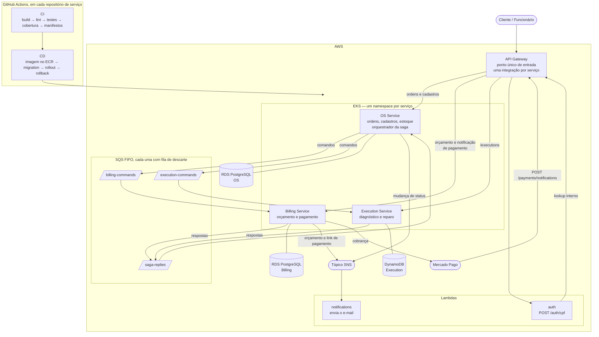
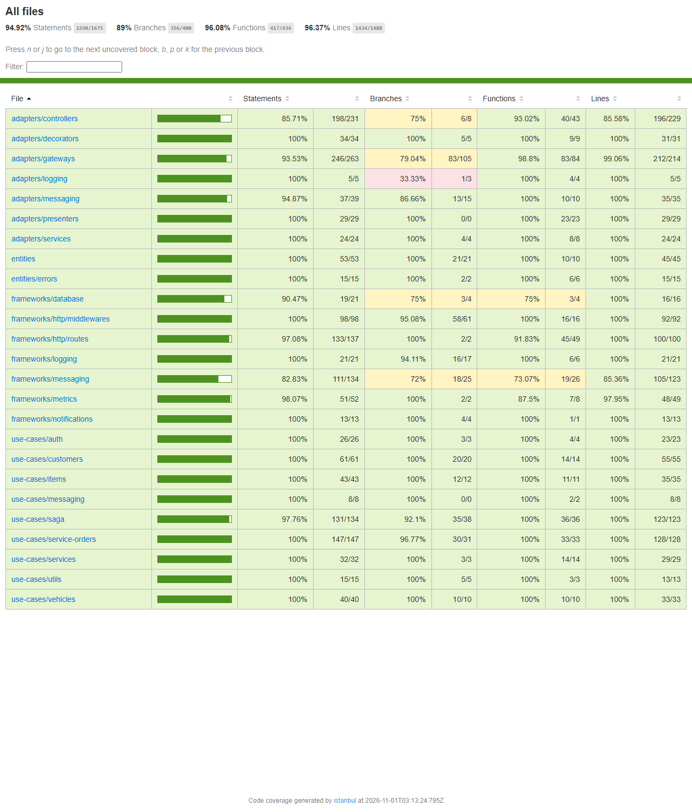

# Car Repair Shop API


**OS Service** da oficina mecânica — FIAP Tech Challenge Fase 4. Este repositório é o serviço de ordens de
serviço, cadastros e estoque, e o **orquestrador da saga** que leva cada ordem pelo Billing Service
(orçamento e pagamento) e pelo Execution Service (diagnóstico e reparo).

**Vídeo demonstrativo:** _a publicar_ — a preparação e o roteiro do que demonstrar estão no
[checklist de gravação](docs/checklist-gravacao.md).

> **Ambiente efêmero.** O sistema é provisionado do zero a cada sessão do Learner Lab e derrubado
> depois, para não consumir orçamento. A URL do API Gateway **muda a cada recriação** — a que
> aparece no vídeo não responde mais. Para subir tudo de novo, siga o
> [runbook do ambiente](docs/runbook-ambiente.md).

---

## Sumário

1. [Sobre a Fase 4](#sobre-a-fase-4)
2. [Sobre a Fase 3](#sobre-a-fase-3)
3. [Documentação arquitetural](#documentação-arquitetural)
4. [Os seis repositórios](#os-seis-repositórios)
5. [Arquitetura](#arquitetura)
6. [Saga da ordem de serviço](#saga-da-ordem-de-serviço)
7. [Stack](#stack)
8. [Papéis de usuário](#papéis-de-usuário)
9. [Execução local — Docker Compose](#execução-local--docker-compose)
10. [Implantação na AWS](#implantação-na-aws)
11. [Observabilidade](#observabilidade)
12. [CI/CD](#cicd)
13. [Testes](#testes)
14. [Postman](#postman)
15. [API Reference (Swagger)](#api-reference-swagger)

---

## Sobre a Fase 4

A Fase 4 dividiu a aplicação em três microsserviços, cada um com repositório, banco, pipeline e
namespace próprios, e trocou a sequência de chamadas manuais por uma saga:

- **OS Service** (este repositório): ordens de serviço, clientes, veículos, catálogo e estoque, em
  PostgreSQL. Orquestra a saga.
- **[Billing Service](https://github.com/diandria/fiap-tech-challenge-billing)**: orçamento, decisão do
  cliente e pagamento pelo Mercado Pago, em PostgreSQL próprio.
- **[Execution Service](https://github.com/diandria/fiap-tech-challenge-execution)**: fila do mecânico,
  diagnóstico, reparo e andamento de cada serviço, em DynamoDB.

Os serviços não compartilham banco e não chamam uns aos outros por HTTP: conversam por filas SQS FIFO,
com outbox transacional de um lado e consumidor idempotente do outro. A
[decisão](docs/architecture/adr/ADR-013-decomposicao-em-microsservicos.md), a
[saga](docs/architecture/adr/ADR-014-saga-orquestrada.md), o
[contrato das mensagens](docs/architecture/adr/ADR-015-comunicacao-e-contrato-de-mensagens.md) e o
[banco por serviço](docs/architecture/adr/ADR-016-banco-por-servico.md) estão nos ADRs 013 a 016, e o
pagamento na [RFC-006](docs/architecture/rfc/RFC-006-integracao-mercado-pago.md).

Cada serviço tem CI com testes, cobertura mínima de 80% e validação dos manifestos, e CD próprio até o
EKS. A jornada principal roda de ponta a ponta em Gherkin contra os três serviços, no compose e no CI
(veja [Testes](#testes)).

---

## Sobre a Fase 3

A Fase 3 levou a aplicação do Minikube local para a AWS, decompôs a autenticação e a notificação em
functions serverless, e instrumentou o sistema para observabilidade:

- **Banco relacional**: Postgres no RDS, com Prisma e migrations aplicadas como Job antes do rollout.
- **Serverless**: autenticação por CPF e notificação por e-mail em Lambdas próprias, com o API
  Gateway como ponto único de entrada.
- **Comunicação híbrida**: síncrona onde há resposta a devolver, assíncrona via tópico SNS onde não
  há — a transição de status não espera o e-mail.
- **Observabilidade**: log estruturado, métricas de negócio e HTTP, tracing distribuído com
  propagação W3C, e o mesmo `trace_id` atravessando a fronteira assíncrona.
- **Dashboards e alertas**: quatro dashboards versionados como código e quatro regras de alerta.
- **Infraestrutura em três repositórios**: banco, cluster e functions, cada um com seu ciclo próprio.

O que veio da Fase 2 continua valendo: Clean Architecture, SOLID, testes com threshold de 80%,
CI/CD no GitHub Actions e HPA por CPU.

---

## Documentação arquitetural

| Documento | Conteúdo |
|---|---|
| [Arquitetura alvo](docs/architecture/target-architecture.md) | Os três serviços, os bancos e as filas da saga |
| [Sequência — saga da ordem de serviço](docs/architecture/sequence-service-order-saga.md) | Caminho feliz, orçamento rejeitado, pagamento recusado e etapa que esgota as tentativas |
| [Diagrama de componentes](docs/architecture/components.md) | Visão dos componentes e das fronteiras |
| [Sequência — autenticação por CPF](docs/architecture/sequence-auth-cpf.md) | Gateway, function e lookup |
| [Sequência — ordem de serviço](docs/architecture/sequence-service-order.md) | Ciclo de vida da OS |
| [Modelo ER](docs/architecture/data-model.md) | Esquema relacional e restrições |
| [Matriz de autorização](docs/architecture/authorization-matrix.md) | As rotas do OS, quem acessa cada uma, e as que passaram para Billing e Execution |
| [Índice de ADRs](docs/architecture/adr/README.md) | 16 decisões de arquitetura |
| [Índice de RFCs](docs/architecture/rfc/README.md) | 6 propostas técnicas |

Operacional: [runbook do ambiente](docs/runbook-ambiente.md),
[checklist de gravação](docs/checklist-gravacao.md),
[política de branches](docs/branching-policy.md).

---

## Os seis repositórios

| Repositório | Responsabilidade |
|---|---|
| [`fiap-tech-challenge`](https://github.com/diandria/fiap-tech-challenge) | OS Service e orquestrador da saga (este) |
| [`fiap-tech-challenge-billing`](https://github.com/diandria/fiap-tech-challenge-billing) | Billing Service: orçamento e pagamento, com o próprio RDS em `terraform/` |
| [`fiap-tech-challenge-execution`](https://github.com/diandria/fiap-tech-challenge-execution) | Execution Service: diagnóstico e reparo, com as tabelas do DynamoDB em `terraform/` |
| [`fiap-tech-challenge-infra-db`](https://github.com/diandria/fiap-tech-challenge-infra-db) | VPC, RDS, segredos no SSM |
| [`fiap-tech-challenge-infra-k8s`](https://github.com/diandria/fiap-tech-challenge-infra-k8s) | EKS, API Gateway, filas da saga, ECR e namespaces dos três serviços, observabilidade |
| [`fiap-tech-challenge-lambda`](https://github.com/diandria/fiap-tech-challenge-lambda) | Functions de autenticação e notificação, tópico SNS |

---

## Arquitetura

### Visão geral da arquitetura



Cada serviço tem o próprio banco, e nenhum lê o banco de outro. Entre eles, só mensagens: o OS manda
comandos para a fila de cada participante e recebe todas as respostas numa fila única
([arquitetura alvo](docs/architecture/target-architecture.md)).

A autenticação por CPF **não passa pelos serviços**: o gateway roteia `POST /auth/cpf` direto para a
Lambda, que consulta o cliente por um endpoint interno do OS e emite o token
([ADR-002](docs/architecture/adr/ADR-002-function-emissora-de-token.md)). Os três serviços validam o
token com o mesmo segredo.

A notificação ao cliente é **assíncrona**: o serviço publica no tópico e segue. A transição de status
não espera o e-mail ([ADR-003](docs/architecture/adr/ADR-003-padrao-de-comunicacao.md)).

### Clean Architecture — camadas

```
src/
├── entities/          ← Layer 1: domínio puro (ServiceOrder, Customer, state machine)
├── use-cases/         ← Layer 2: regras de aplicação + ports/interfaces
│   └── ports/         ← abstrações (IServiceOrderRepository, IStatusChangeNotifier…)
├── adapters/          ← Layer 3: controllers, gateways, presenters
└── frameworks/        ← Layer 4: Express, Prisma, rotas, main.ts
```

---

## Saga da ordem de serviço

Abrir, orçar, aprovar, cobrar e reparar uma ordem passa por três serviços, cada um com o próprio banco.
Não existe mais a transação única do monolito: o OS garante a abertura e a reserva de estoque numa
transação local, mas não consegue garantir na mesma transação que o Billing gerou o orçamento ou que o
pagamento foi aprovado. Parte das falhas também é de negócio, e não se resolve tentando de novo: o cliente
rejeita o orçamento, o cartão é recusado. A saga resolve isso como uma sequência de transações locais
coordenadas por mensagens, em que cada etapa que pode precisar ser desfeita tem uma compensação.

### Por que orquestrada, e por que no OS

A transação distribuída (two-phase commit) foi descartada logo: PostgreSQL, DynamoDB e SQS não participam
do mesmo protocolo, e o fluxo espera decisões humanas, como a aprovação do cliente e o pagamento, que
podem levar dias com recursos bloqueados.

Entre coreografia e orquestração, a escolha foi **orquestração, com o orquestrador dentro do OS**
([ADR-014](docs/architecture/adr/ADR-014-saga-orquestrada.md)):

- **O fluxo fica escrito num lugar só.** A sequência e todas as compensações estão em
  `src/use-cases/saga/ServiceOrderSaga.ts`, legíveis e testáveis. Na coreografia, entender o caminho de
  uma ordem exigiria ler os três serviços.
- **Sem dependência cíclica.** As mensagens vão num sentido (comando do orquestrador para o participante,
  resposta de volta). Na coreografia, OS e Execution assinariam os eventos um do outro.
- **Os participantes não sabem que fazem parte de uma saga.** Billing e Execution recebem comandos e
  respondem. Nenhum deles decide quando a ordem avança ou compensa.
- **O estado da saga é o status da ordem**, que o OS já guarda. Um serviço só de coordenação teria de
  duplicar esse estado ou consultar o OS a cada passo.

O custo é conhecido: o orquestrador concentra regra, e com o OS fora do ar nenhuma saga avança, embora
nenhuma se perca, porque as respostas esperam na fila.

### Etapas e compensações

| # | Serviço | O que acontece | Mensagens | Se recusar ou falhar |
|---|---|---|---|---|
| 1 | OS | Abre a ordem em `RECEIVED` e reserva o estoque | emite `EnqueueDiagnosis` | Libera a reserva, `CANCELLED` |
| 2 | Execution | O mecânico inicia e conclui o diagnóstico | `DiagnosisStarted`, `DiagnosisCompleted` | `CancelExecution` |
| 3 | Billing | Gera o orçamento e avisa o cliente | `GenerateBudget` → `BudgetGenerated` | `CancelBudget` |
| 4 | Billing | O cliente decide | `BudgetApproved` ou `BudgetRejected` | Rejeição: libera a reserva, `REJECTED`, `CancelExecution` |
| 5 | Billing | Cobra pelo Mercado Pago | `RequestPayment` → `PaymentConfirmed` ou `PaymentFailed` | Recusa: libera a reserva, `CANCELLED`, `CancelExecution` e `CancelBudget` |
| 6 | OS | Baixa o estoque e marca `PAID` | emite `EnqueueRepair` | — |
| 7 | Execution | O mecânico faz o reparo e marca cada serviço | `RepairStarted`, `RepairCompleted` | — |
| 8 | OS | Marca `FINISHED`; a entrega continua sendo registrada pelo mecânico | — | — |

O **pagamento confirmado é o ponto de não retorno**. Antes dele, toda etapa tem compensação. Depois dele,
não há o que desfazer, só o que terminar, e as etapas são tentadas de novo até concluir.

Cada resposta é aplicada numa única transação local no OS: o status, o histórico, o estoque, o registro
da mensagem já processada e os comandos de saída no outbox, juntos. Antes de aplicar, o orquestrador relê
a ordem e confere se ela está no status que a resposta espera. A gravação usa controle otimista de versão.

### Quando algo sai do ar

| Situação | O que acontece |
|---|---|
| Execution fora do ar | Os comandos esperam em `execution-commands`. As ordens novas ficam em `RECEIVED` e seguem quando ele volta |
| Billing fora do ar | `GenerateBudget` e `RequestPayment` esperam em `billing-commands`. A ordem fica em `WAITING_APPROVAL` ou `APPROVED` até ele voltar |
| OS fora do ar | Nenhuma saga avança, e nenhuma se perde: as respostas esperam em `saga-replies` |
| Fila inacessível | As mensagens ficam no outbox de quem as gravou, e o relay tenta de novo. O alerta `OutboxBacklog` dispara se nada sai por 5 minutos |
| Mensagem que falha sempre | Volta para a fila a cada 30 segundos. Na quinta falha vai para a fila de descarte, e o OS trata como falha da etapa: compensa até o pagamento, e depois disso registra a etapa como travada e alerta (`SagaStepStuck`) |

Nenhuma dessas situações exige intervenção manual para não perder dados. Só a etapa travada precisa de
alguém: o log de erro do OS traz o id da ordem e a mensagem inteira.

### Como acompanhar uma saga

- **Histórico da ordem:** `GET /service-orders/{id}/history` mostra cada mudança de status, em ordem.
- **Painel "Oficina — Saga da ordem de serviço"** no Grafana: respostas por tipo e resultado,
  compensações por motivo, backlog do outbox e falhas de consumo por serviço.
- **Trace:** no mesmo painel, o campo **ID da OS** busca no Tempo os traces com o atributo
  `service_order.id`, que os três serviços gravam nos spans de mensageria. O trace mostra OS, fila e
  participante juntos.
- **Logs:** no Loki, `{namespace=~"car-repair-shop.*"} |= "<id da OS>"` traz os logs dos três serviços
  sobre a ordem.
- **Alertas:** `SagaMessageFailing`, `OutboxBacklog`, `SagaCompensationsSpike` e `SagaStepStuck`,
  descritos no README do `infra-k8s`.

As compensações têm cenários BDD no nível de componente (`tests/bdd/service-order-saga.feature`), e a
jornada principal e a recusa de pagamento rodam de ponta a ponta contra os três serviços
(`tests/e2e/service-order-journey.feature`).

---

## Stack

| Tema | Escolha |
|---|---|
| Runtime | Node.js 22 LTS + TypeScript |
| HTTP | Express |
| Banco | PostgreSQL 16 + Prisma (OS e Billing); DynamoDB (Execution) |
| Mensageria | SQS FIFO com outbox transacional e consumidor idempotente ([ADR-015](docs/architecture/adr/ADR-015-comunicacao-e-contrato-de-mensagens.md)) |
| Auth | JWT (jsonwebtoken) + bcryptjs |
| Log | pino — JSON estruturado ([ADR-010](docs/architecture/adr/ADR-010-biblioteca-de-log.md)) |
| Métricas | prom-client — HTTP, negócio e falhas de integração |
| Tracing | OpenTelemetry, propagação W3C `traceparent` |
| Notificações | AWS SDK v3 (SNS) em produção; console em desenvolvimento |
| Docs API | swagger-ui-express + swagger-jsdoc |
| Testes | Jest + ts-jest + Supertest + Testcontainers (Postgres e LocalStack) + jest-cucumber |
| Container | Docker + docker-compose |
| Orquestração | Kubernetes (Amazon EKS) |
| IaC | Terraform — nos três repositórios de infraestrutura |
| CI/CD | GitHub Actions, ambos em runner hospedado |

> **Node 22, e não 20.** O `testcontainers` adotado na migração para Postgres arrasta `undici@8`,
> que exige `>=22.19.0`, e o Node 20 saiu de suporte em abril de 2026.

---

## Papéis de usuário

O sistema tem **dois fluxos de autenticação**, com emissores diferentes.

**Funcionário** — `POST /auth/login` (e-mail e senha), emitido pela própria aplicação:

| Role | Permissões |
|---|---|
| `attendant` | Abre OS; cadastra clientes e veículos |
| `mechanic` | Inicia e conclui diagnóstico e reparo no Execution; refina serviços e itens da OS; registra a entrega |
| `admin` | Acesso total — inclui gestão de catálogo, estoque e usuários |

**Cliente** — `POST /auth/cpf` no API Gateway, emitido pela function serverless. O cliente consulta o
status e decide o orçamento **apenas da própria OS**: a titularidade é verificada dentro do caso de
uso, e não só a autenticação.

A confirmação com os primeiros 4 dígitos do CPF/CNPJ **permanece** em `PATCH
/service-orders/:id/budget`, que desde a Fase 4 é atendida pelo Billing Service no mesmo caminho. O
token diz *quem* está agindo; o código diz que a pessoa quis aprovar *aquele* orçamento, e não clicou
por engano.

> **A matriz completa** de rotas, perfis e fluxos está em
> [`docs/architecture/authorization-matrix.md`](docs/architecture/authorization-matrix.md) — todas as
> rotas, quem acessa cada uma, o critério das que continuam públicas e as que passaram para o Billing
> e o Execution.

---

## Execução local — Docker Compose

### Pré-requisitos

- Docker + docker-compose
- Node.js 22+ (apenas para `npm install` e `seed:dev`)

### 1. Variáveis de ambiente

```bash
cp .env.example .env
```

Edite `.env` se precisar mudar `ADMIN_PASSWORD` ou `JWT_SECRET`.

### 2. Subir os containers

```bash
npm install
docker-compose up -d
```

Sobe `app` (porta 3000), `postgres` (porta 5432) e `localstack` (porta 4566), que faz o papel do SQS.
Ao ficar pronto, o LocalStack roda `scripts/localstack/create-queues.sh` e cria as filas da saga com os
mesmos nomes e parâmetros da AWS, cada uma com sua fila de descarte. Para conferir:

```bash
docker exec car-repair-shop-localstack awslocal sqs list-queues
```

A imagem fica fixa na `4.9.2` porque as versões mais novas do LocalStack só sobem com um token de licença.
Os testes de integração de mensageria sobem o próprio LocalStack pelo Testcontainers e não dependem deste
container.

Na primeira execução, aplique as migrations:

```bash
npm run db:migrate
```

### 3. Popular o banco (opcional)

```bash
npm run seed:dev
```

Cria 5 serviços, 6 itens, 4 clientes, 7 veículos e 3 usuários (`admin@dev.local`, `attendant@dev.local`, `mechanic@dev.local`, senha `dev123`).

### 4. Verificar

```bash
curl http://localhost:3000/health
```

- API: <http://localhost:3000>
- Swagger: <http://localhost:3000/docs>

### Parar

```bash
docker-compose down          # mantém dados
docker-compose down -v       # remove volumes
```

### O que **não** roda localmente

Ser explícito aqui vale mais que fingir cobertura total: quem tentar e travar vai concluir que a
documentação está errada, e vai estar certo.

| Componente | Local | Observação |
|---|---|---|
| API + Postgres | sim | `docker-compose up -d` |
| Os três serviços e a saga | sim | `e2e/docker-compose.yml` sobe OS, Billing e Execution com LocalStack (veja [Testes](#testes)) |
| Notificações | sim, no console | `NOTIFICATION_CHANNEL=console` imprime a mensagem em vez de publicar no SNS |
| **Autenticação por CPF** | **não** | `POST /auth/cpf` é servida pela Lambda, atrás do API Gateway — nenhum dos dois existe localmente |
| Observabilidade | não | Loki, Tempo, Prometheus e Grafana vivem no cluster; localmente os logs saem em JSON no stdout e as métricas ficam em `/metrics` |

**Como testar rotas de cliente sem o gateway:** autentique como `admin` em `POST /auth/login` e use
esse token. A titularidade é verificada dentro do caso de uso, então o comportamento de negócio é o
mesmo; o que não dá para exercitar localmente é a emissão do token pela function.

---

## Implantação na AWS

A aplicação roda em **Amazon EKS**, com Postgres no **RDS**, imagem no **ECR** e o **API Gateway**
como ponto único de entrada (ADR-001). O ambiente da Fase 2 (Minikube local, com runner
self-hosted) foi removido.

### Topologia

```
        internet
            │
    ┌───────▼────────┐
    │  API Gateway   │  throttling, rotas enumeradas
    └───────┬────────┘
            │ VPC Link
    ┌───────▼────────┐
    │  NLB interno   │  nunca público
    └───────┬────────┘
            │
    ┌───────▼────────┐      ┌──────────────┐
    │  EKS  (2 pods) │─────▶│  RDS Postgres│
    └───────┬────────┘      └──────────────┘
            │ SNS
    ┌───────▼────────────────┐
    │ Lambda de notificações │
    └────────────────────────┘
```

`POST /auth/cpf` é servida pela **Lambda de autenticação**, não pela aplicação.

### Repositórios de infraestrutura

| Repositório | Responsabilidade |
|---|---|
| `fiap-tech-challenge-infra-db` | VPC, RDS, segredos no SSM |
| `fiap-tech-challenge-infra-k8s` | EKS, API Gateway, ECR, observabilidade |
| `fiap-tech-challenge-lambda` | Functions de autenticação e notificação, tópico SNS |

A divisão segue o ciclo de vida: o `infra-k8s` provisiona o **ambiente** (cluster, node group, rede,
addons, observabilidade, API Gateway) e este repositório versiona os **artefatos de deploy da
aplicação** — Deployment, Service, HPA, ConfigMap e o Job de migration.

O **Namespace** fica no `infra-k8s`: ele existe antes de qualquer deploy e sobrevive a todos eles.

O **Service** mora aqui e é ele que faz nascer o NLB interno. Isso cria uma ordem de provisionamento:
a integração do API Gateway precisa do ARN do listener desse NLB, então ela é aplicada numa segunda
fase do `infra-k8s`, depois que o Service subiu. O [runbook](docs/runbook-ambiente.md) descreve a
sequência.

### Como implantar

O deploy é automático: merge na `main` → CI → CD. Não há passo manual.

O **runbook do ambiente efêmero** (subida completa a partir do zero, ordem obrigatória e descida)
está em [`docs/runbook-ambiente.md`](docs/runbook-ambiente.md).

### Ambiente único

O projeto usa **um ambiente só**. Não há homologação: `main` é produção.

```
<tipo>/<slug>  →  PR  →  revisão  →  merge na main  →  CD  →  produção
```

Isso é consequência do contexto — entrega acadêmica, ambiente efêmero recriado a cada sessão do
Learner Lab, com orçamento limitado. **Não é uma decisão de arquitetura, e por isso não tem ADR:**
um ADR que defendesse a escolha estaria fabricando argumento técnico para uma restrição.

O que substitui a rede de proteção que a homologação daria:

| Rede de proteção | Como é coberta |
|---|---|
| Regressão funcional | Suíte de integração com Postgres real via Testcontainers, obrigatória no CI |
| Erro de configuração de manifest | `kubeconform -strict` no CI, sem precisar de cluster |
| Migration destrutiva | Job próprio, antes do rollout, com `backoffLimit: 0` |
| Deploy quebrado | `rollout status` com **rollback automático**, e o workflow termina em vermelho |
| Revisão | PR obrigatório; nenhum push direto na `main` |
| Segredo divergente entre serviços | Todos leem o **mesmo parâmetro SSM** — não há cópias para divergir |

O ponto fraco que permanece: **não há ensaio antes de produção**. Uma falha só descoberta em runtime
chega ao ambiente real, e a mitigação é o rollback, não a prevenção.

### Manifests Kubernetes (`/k8s/`)

| Arquivo | Conteúdo |
|---|---|
| `01-config/configmap.yaml` | Configuração estática |
| `02-service/app-service.yaml` | Service `LoadBalancer` interno; origem do NLB |
| `03-app/app-deployment.yaml` | Deployment, sondas, requests e limits |
| `03-app/app-hpa.yaml` | HPA, 2 a 10 réplicas, 70% de CPU |
| `03-app/app-pdb.yaml` | PodDisruptionBudget |
| `04-jobs/migrate.yaml` | Job de migration, executado antes do rollout |

A configuração que vem da infraestrutura (endereço do Tempo, ARN do tópico) é criada pelo CD num
ConfigMap separado, `car-repair-shop-runtime`. Ela muda a cada ambiente recriado, e versioná-la
deixaria no repositório um valor que já não existe.

### Demonstrar o HPA (teste de carga com k6)

```bash
kubectl get hpa -n car-repair-shop -w
k6 run scripts/load-test.js
```


## Observabilidade

Três sinais, correlacionados pelo mesmo `trace_id`.

| Sinal | Onde | O que expõe |
|---|---|---|
| Log | Loki | JSON estruturado com `trace_id`, `span_id`, rota, status e duração |
| Métrica | Prometheus | latência HTTP por rota, OS abertas, tempo até cada status, falhas de integração |
| Trace | Tempo | spans da requisição, com propagação W3C `traceparent` |

O `trace_id` **atravessa a fronteira assíncrona**: a aplicação publica o `traceparent` no evento SNS
e a function de notificações o registra no próprio log. O mesmo identificador aparece dos dois lados,
apesar de não haver chamada síncrona entre eles.

Os dashboards e as regras de alerta são versionados como código no
[`infra-k8s`](https://github.com/diandria/fiap-tech-challenge-infra-k8s) — painel montado pela UI se
perderia no teardown do cluster.

| Dashboard | Conteúdo |
|---|---|
| Volume de ordens de serviço | Contagem e taxa de abertura |
| Tempo até cada status | Percentis e média por transição |
| Latência, healthchecks e uptime | p50/p95/p99 por rota, taxa de erro, uptime |
| Recursos do Kubernetes | CPU e memória contra requests e limites, réplicas contra o HPA |

Endpoint de métricas da aplicação: `GET /metrics`.

---

## CI/CD

### CI (`.github/workflows/ci.yml`)

Dispara em push e pull request para `main`. Roda em `ubuntu-latest`.

| Job | Necessita | Comando |
|---|---|---|
| `build` | — | `npm ci && npm run build` |
| `lint` | build | `npm run lint` |
| `test` | build | `npm test` |
| `coverage` | build, test | `npm run test:coverage` — faz upload do relatório como artefato |
| `sonar` | coverage | Análise no [SonarQube Cloud](https://sonarcloud.io/project/overview?id=diandria_fiap-tech-challenge) com o relatório de cobertura do job anterior; reprova quando o quality gate reprova |

O job `BDD end-to-end` (`.github/workflows/e2e.yml`) roda à parte, em todo PR e em todo push na `main`:
sobe os três serviços no compose de `e2e/` e executa os cenários de ponta a ponta. Ele não é checagem
obrigatória da `main`, porque depende da `main` do Billing e do Execution.

### CD (`.github/workflows/cd.yml`)

Dispara via `workflow_run` quando o CI conclui com sucesso em `main`. Roda em runner hospedado do GitHub.

Passos: checkout no SHA exato → build e push da imagem no ECR com tag do SHA → leitura da configuração do SSM e do RDS → ConfigMap e Secret → **Job de migration** → `kubectl set image` → `rollout status` → **rollback automático** se falhar → verificação de fumaça em `/health` pelo gateway.

Os segredos vêm do **SSM**, não de secrets do GitHub: `JWT_SECRET` e `INTERNAL_TOKEN` são escritos ali pelo Terraform das functions, e a aplicação lê o mesmo parâmetro. Não existem duas cópias para divergir.

O ConfigMap de runtime recebe também as URLs das filas da saga, criadas pelo `infra-k8s`: as três filas
(`billing-commands`, `execution-commands` e `saga-replies`) e as filas de descarte dos dois comandos, que o
OS lê para compensar uma etapa que esgotou as tentativas. Se alguma não existir, o deploy para antes de
aplicar qualquer coisa, porque o serviço se recusa a subir com só parte delas.

**GitHub Secrets necessários** (`Settings → Secrets and variables → Actions`):

| Secret | Descrição |
|---|---|
| `AWS_ACCESS_KEY_ID` | Credencial do Learner Lab |
| `AWS_SECRET_ACCESS_KEY` | Credencial do Learner Lab |
| `AWS_SESSION_TOKEN` | Credencial do Learner Lab — expira em ~4h |

São só esses três. `JWT_SECRET`, `INTERNAL_TOKEN` e a senha do admin **não** são secrets do GitHub:
vêm do SSM, escritos pelo Terraform. Mantê-los aqui recriaria duas cópias do que deve ser um valor
só.

As credenciais do Learner Lab expiram junto com a sessão. Para renová-las em todos os repositórios:

```bash
~/dev/fiap-tech-challenge-lambda/scripts/refresh-aws-secrets.sh --all
```

Cada deploy fica registrado em **Deployments → production**.

---

## Testes

```bash
npm test                  # unitários e integração (Testcontainers sobe Postgres e LocalStack)
npm run test:coverage     # com relatório de cobertura (threshold ≥ 80%)
```

Os testes de integração seguem GIVEN / WHEN / THEN, no título e no corpo. As compensações da saga têm
cenários em Gherkin no nível de componente, em `tests/bdd/`: o orquestrador real, com Billing e
Execution simulados.

### Cobertura

O mínimo de 80% vale para linhas, branches, funções e statements, e o `npm run test:coverage` falha
abaixo dele. O job `Coverage` do [CI](https://github.com/diandria/fiap-tech-challenge/actions/workflows/ci.yml)
roda em todo PR e guarda o relatório HTML como artefato do run.

| Linhas | Statements | Funções | Branches |
|---|---|---|---|
| 96,37% | 94,92% | 96,08% | 89% |



### Ponta a ponta com os três serviços

`tests/e2e/service-order-journey.feature` descreve, em Gherkin, a jornada principal da OS e a recusa de
pagamento contra o OS, o Billing e o Execution de verdade. Os três conversam só pelas filas da saga. O
`e2e/docker-compose.yml` sobe as mesmas imagens de produção, com dois Postgres, LocalStack para SQS e
DynamoDB, pagamento simulado e avisos ao cliente no console. Os três repositórios precisam estar lado a
lado, como em `~/dev`:

```bash
docker compose -f e2e/docker-compose.yml up --build -d --wait
npm run test:e2e
docker compose -f e2e/docker-compose.yml down -v
```

Como a saga é assíncrona, cada passo espera o estado com prazo de 30 segundos em vez de conferir na hora.
Quando o prazo estoura, a mensagem diz o que estava lá. O token de cliente é assinado no teste com o
segredo compartilhado do compose, porque a função de autenticação não roda localmente. O admin entra pelo
login real do OS.

No CI, o job `BDD end-to-end` (`.github/workflows/e2e.yml`) faz o mesmo em todo PR e em todo push na
`main`, com o Billing e o Execution tirados da `main` deles. Ele não é checagem obrigatória: uma quebra
num dos outros repositórios não pode travar um PR aqui. Em falha, os logs dos serviços ficam como artefato
do run.

### SonarQube Cloud

A análise de qualidade roda no CI de todo PR e de todo push na `main`, no
[projeto do OS no SonarQube Cloud](https://sonarcloud.io/project/overview?id=diandria_fiap-tech-challenge),
da organização `diandria`. O scanner espera o quality gate (`sonar.qualitygate.wait`) e o job `SonarQube`
falha quando ele reprova, ou quando o segredo `SONAR_TOKEN` não está configurado: uma checagem que passa
sem analisar nada seria pior que nenhuma. O quality gate é o padrão do SonarQube Cloud (Sonar way), que
avalia o código novo de cada PR.

`sonar.coverage.exclusions` repete os arquivos que o jest deixa fora da cobertura de propósito (montagem
da aplicação, Swagger, clientes que só existem contra infraestrutura real). Sem isso, um PR que mexesse
neles reprovaria na cobertura do código novo.

Para analisar localmente, com um SonarQube na própria máquina:

```bash
docker-compose --profile sonar up -d sonarqube sonar-db
# 1. Acessar http://localhost:9000 (admin/admin → trocar senha)
# 2. Gerar token em My Account → Security
# 3. Preencher SONAR_HOST_URL e SONAR_TOKEN no .env

npm run test:coverage && npm run sonar
```

---

## Postman

A pasta `postman/` contém a coleção e os environments para cada ambiente.

| Environment | Arquivo | `baseUrl` |
|---|---|---|
| Local / Docker Compose | `car-repair-shop.postman_environment.json` | `http://localhost:3000` |
| Kubernetes / AWS | `car-repair-shop-k8s.postman_environment.json` | URL do API Gateway |

Importar: **Import → Upload Files** → selecione a collection + o environment desejado.

Para o ambiente na AWS, preencha `baseUrl` e `authBaseUrl` com a URL do API Gateway (`terraform output api_gateway_url` no `infra-k8s`).

Via CLI com Newman:

```bash
npx newman run postman/car-repair-shop.postman_collection.json \
  -e postman/car-repair-shop.postman_environment.json
```

Veja [`postman/README.md`](postman/README.md) para o fluxo detalhado.

---

## API Reference (Swagger)

| Ambiente | URL |
|---|---|
| Docker Compose | <http://localhost:3000/docs> |
| AWS | `<url-do-api-gateway>/docs` — obtenha com `terraform output -raw api_gateway_url` no `infra-k8s` |

### Autenticar no Swagger UI

1. `POST /auth/login` → **Try it out** → `{ "email": "admin@master.com", "password": "<ADMIN_PASSWORD>" }`
2. Copie o `token`
3. **Authorize** (cadeado) → cole o token sem o prefixo `Bearer ` → **Authorize**

### Endpoints públicos

| Endpoint | Descrição |
|---|---|
| `POST /auth/login` | Autentica e retorna JWT |
| `GET /health` | Liveness probe |
| `GET /ready` | Readiness probe |

### Endpoints de cliente

Exigem o token emitido pela function em `POST /auth/cpf`, e só funcionam para a OS do próprio
cliente. Não estão no Swagger da aplicação com o cadeado de staff: no Swagger UI, use o esquema
`customerBearerAuth`.

| Endpoint | Descrição |
|---|---|
| `GET /service-orders/:id/status` | Lê status e orçamento da OS |
| `PATCH /service-orders/:id/budget` | Aprova ou rejeita orçamento; exige o `code`. Atendida pelo **Billing Service**, pelo mesmo caminho no gateway |

