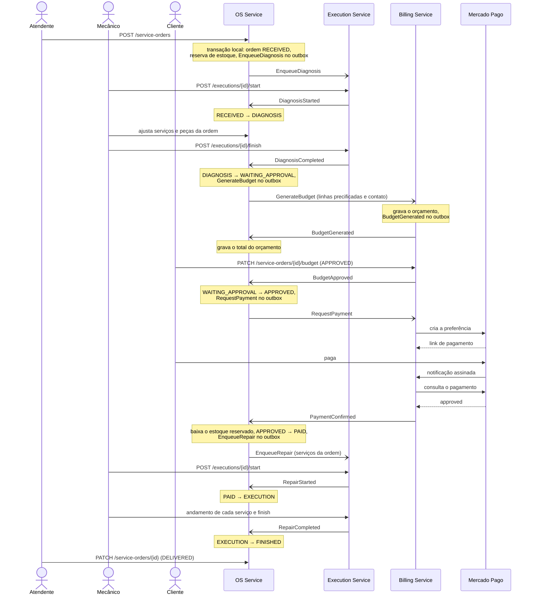
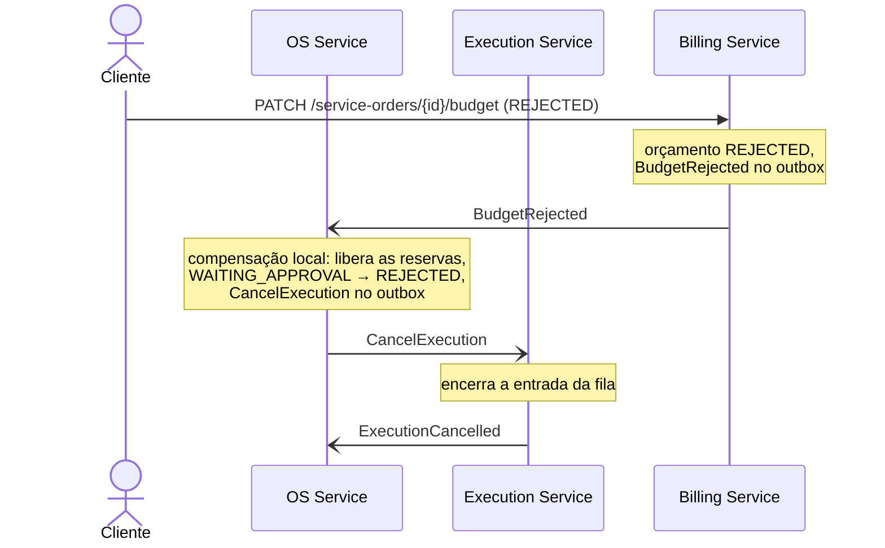
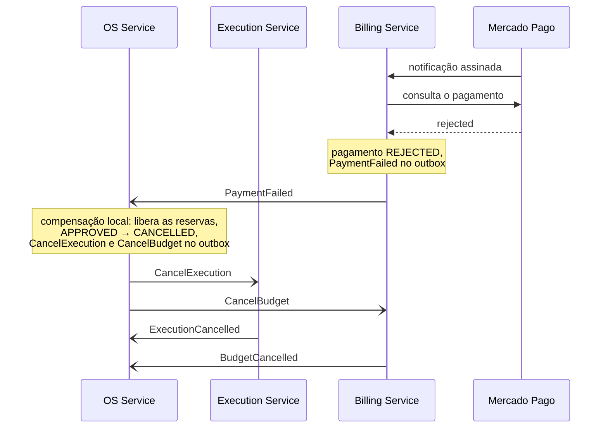

# Diagramas de sequência (saga da ordem de serviço)

Nível de serviço. As regras de cada etapa estão no [ADR-014](adr/ADR-014-saga-orquestrada.md), e o
contrato das mensagens no [ADR-015](adr/ADR-015-comunicacao-e-contrato-de-mensagens.md). Toda chamada HTTP
passa pelo API Gateway, que fica fora dos diagramas para não repetir uma seta em cada passo.

Setas cheias são chamadas HTTP; setas abertas são mensagens nas filas. As notas marcam onde acontece cada
transação local e qual mensagem ela grava no outbox, porque é isso que garante que a mudança de estado e a
mensagem saem juntas.

## 1. Caminho feliz: da abertura à entrega



## 2. Orçamento rejeitado

A ordem já tem estoque reservado e uma entrada encerrada de diagnóstico no Execution. A rejeição desfaz as
duas coisas.



## 3. Pagamento recusado

A recusa chega antes do ponto de não retorno, então tudo o que foi feito até ali é desfeito: reserva de
estoque, entrada da fila e orçamento.



## 4. Etapa que esgota as tentativas

O Billing recebe o pedido de orçamento e não consegue processá-lo. Depois do quinto recebimento, a fila
move a mensagem para a fila de descarte, e o OS trata isso como falha da etapa.

```mermaid
sequenceDiagram
    participant OS as OS Service
    participant Q as Fila de comandos do Billing
    participant BI as Billing Service
    participant D as Fila de descarte
    participant EX as Execution Service

    OS-)Q: GenerateBudget
    loop cinco recebimentos
        Q-)BI: GenerateBudget
        Note over BI: falha ao processar;<br/>a mensagem não é confirmada
    end
    Q-)D: move a mensagem
    D-)OS: GenerateBudget que falhou
    Note over OS: compensação local: libera as reservas,<br/>WAITING_APPROVAL → CANCELLED,<br/>CancelExecution no outbox
    OS-)EX: CancelExecution
    EX-)OS: ExecutionCancelled
```

Um participante fora do ar não aparece aqui: nesse caso, os comandos só esperam na fila e a saga continua
quando ele volta, sem compensação.

Depois do pagamento confirmado não há o que compensar. Se o `EnqueueRepair`, ou um comando de
compensação, esgota as tentativas, o OS não muda a ordem: registra o erro com a mensagem inteira, conta
em `saga_stuck_total` e o alerta `SagaStepStuck` chama alguém.
