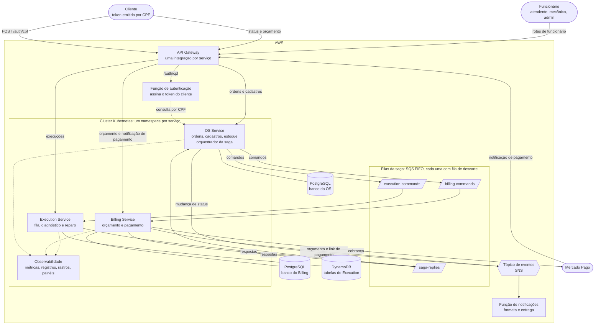

# Arquitetura alvo (microsserviços)

Visão geral da arquitetura com os três microsserviços, os bancos de cada um e os canais de comunicação. As
decisões estão no [ADR-013](adr/ADR-013-decomposicao-em-microsservicos.md) (divisão), no
[ADR-014](adr/ADR-014-saga-orquestrada.md) (saga), no
[ADR-015](adr/ADR-015-comunicacao-e-contrato-de-mensagens.md) (comunicação) e no
[ADR-016](adr/ADR-016-banco-por-servico.md) (bancos). Os fluxos estão nos
[diagramas de sequência da saga](sequence-service-order-saga.md).

## Visão geral

## Como ler

- **Serviços.** Cada serviço tem repositório, banco, pipeline e namespace próprios. O OS coordena o fluxo da
  ordem; Billing e Execution executam as etapas que são deles e respondem.
- **Bancos.** Dois relacionais e um não relacional, um por serviço. Nenhum serviço conhece o endereço ou a
  credencial do banco de outro.
- **Comunicação síncrona.** Só na borda: cliente e funcionário falam com os serviços pelo API Gateway, e a
  função de autenticação consulta o OS para emitir o token.
- **Comunicação assíncrona.** Entre os serviços, só mensagens. O OS publica comandos na fila de cada
  participante e consome as respostas numa fila única. As filas são FIFO, ordenadas por ordem de serviço.
- **Notificações.** Mudança de status, orçamento pronto e link de pagamento saem pelo tópico de eventos da
  Fase 3, e a função de notificações entrega ao cliente.
- **Observabilidade.** Os três serviços enviam métricas, registros e rastros para a mesma stack da Fase 3.
  O rastro atravessa as filas, porque toda mensagem carrega o contexto de quem a publicou, e o span de
  cada mensagem leva o id da ordem (`service_order.id`), o que permite buscar no Tempo todos os rastros de
  uma ordem. O painel da saga e os alertas de mensageria (mensagem falhando, outbox parado, compensações
  acima do normal e etapa travada) ficam no `infra-k8s`.

## Quem provisiona o quê

| Recurso | Repositório |
|---|---|
| Banco do OS | `fiap-tech-challenge-infra-db` |
| Banco do Billing | `fiap-tech-challenge-billing` (`terraform/`) |
| Tabelas do Execution | `fiap-tech-challenge-execution` (`terraform/`) |
| Cluster, namespaces, API Gateway, filas da saga, registro de imagens, observabilidade | `fiap-tech-challenge-infra-k8s` |
| Funções de autenticação e de notificações, tópico de eventos | `fiap-tech-challenge-lambda` |
| Manifestos e pipeline de cada serviço | repositório do próprio serviço |
